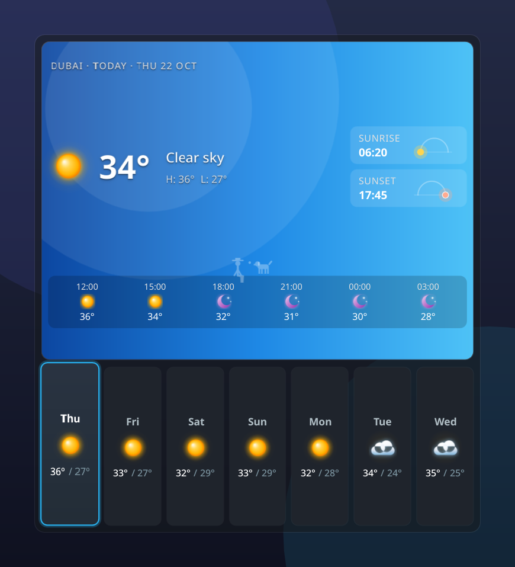
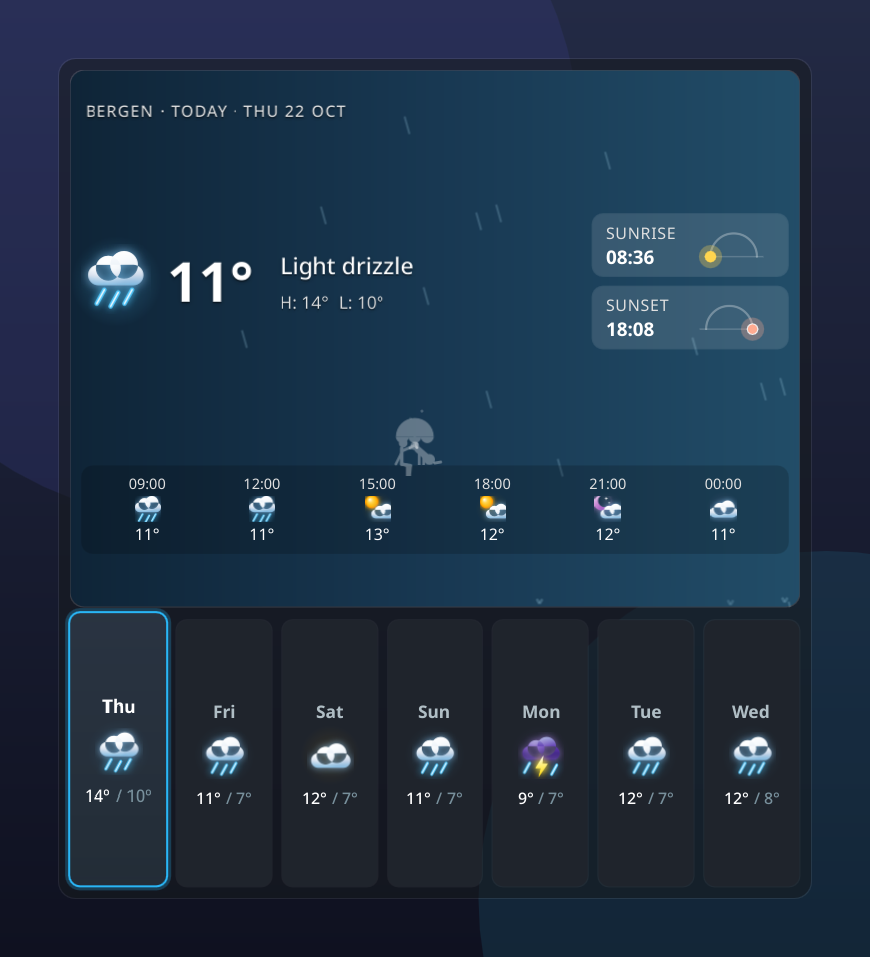
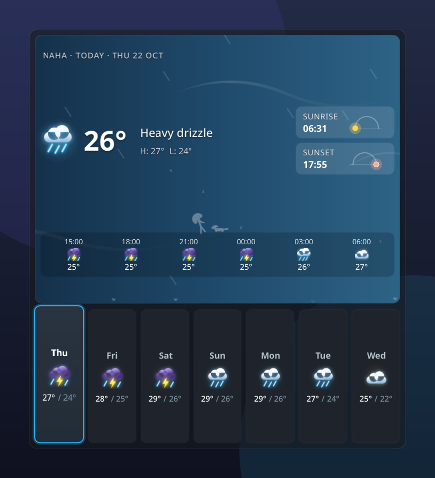
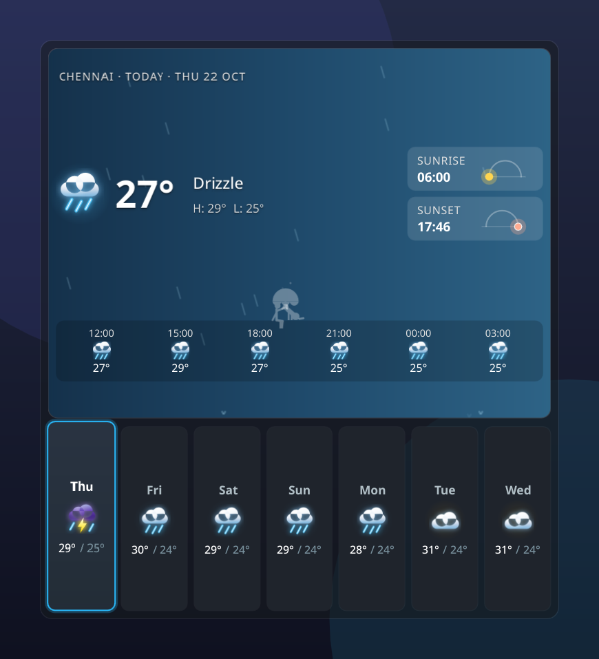
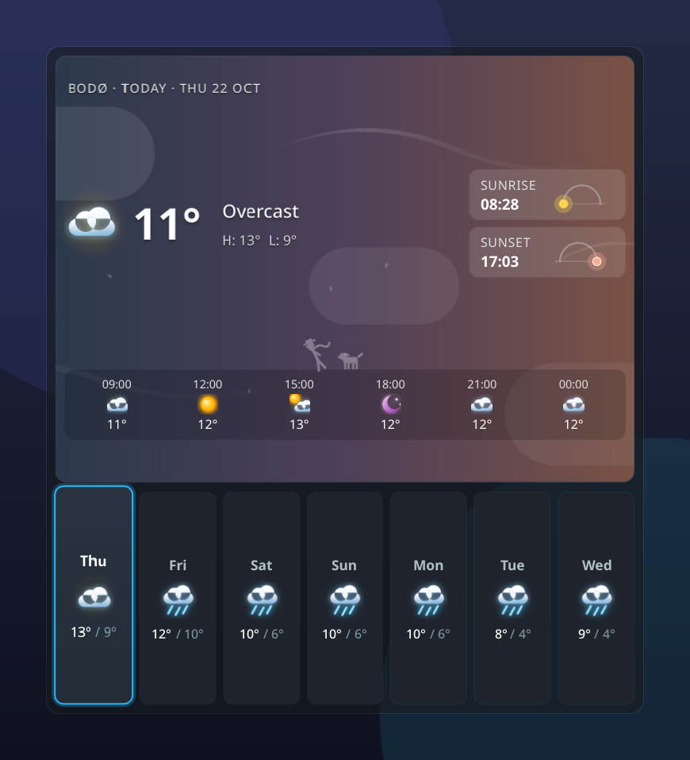
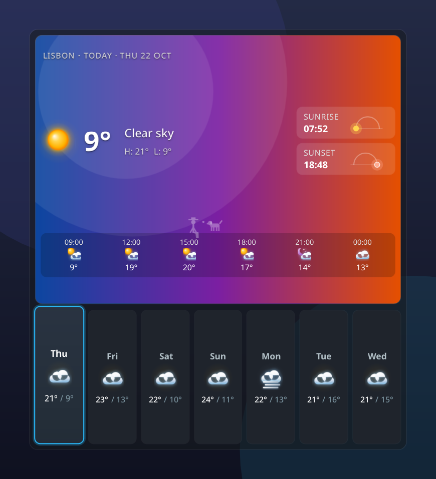
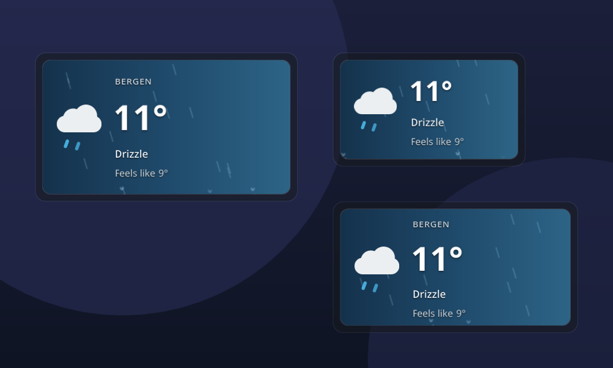
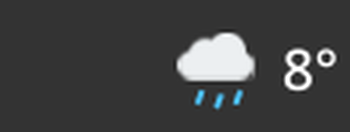
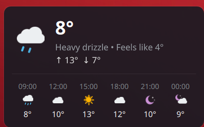

# Umbra Weather

A weather widget for KDE Plasma 6 with an animated condition icon in the panel,
a hover forecast, and a resizable desktop card that goes from a full weekly view
with ambient weather animations down to a compact tile.

- Current conditions and a 7-day forecast from [Open-Meteo](https://open-meteo.com/), no API key needed
- Panel item with an animated icon that plays on hover, on a condition change, and every few minutes
- Hover popup with the next hours and today's details
- Desktop card with sunrise and sunset, an hourly strip, and ambient weather animations
  (wind-driven rain, flowing wind ribbons, drifting clouds, snow, lightning)
- Resizable desktop card: the hourly strip, sunrise/sunset cards and 7-day row
  fold away smoothly as it shrinks, and below 340x260 it becomes a miniature
  tile with the icon, temperature, condition and feels-like temperature
- A small silhouette duo, a person and their dog, that react to the weather on the hourly strip
- Three icon styles: volumetric glass, hand-drawn animated, and the Weather Underground sets
- Metric or imperial units, configurable refresh interval

## Screenshots

| | |
| --- | --- |
|  |  |
|  |  |
|  |  |



 

## Install

From the KDE Store: right-click the panel or desktop, choose *Add Widgets*, then
*Get New Widgets* and search for "Umbra Weather".

From source:

```sh
kpackagetool6 --type Plasma/Applet --install package
```

To update an existing install use `--upgrade` instead of `--install`.

## Settings

Right-click the widget and choose *Configure*. Type a place name to look it
up: the first match is used right away and, when there are several, you can
pick another from the list. *Detect* takes an approximate location from your
internet connection. The icon style, temperature and wind units, refresh
interval, the translucent card background, the ambient animations and the
weather character can all be switched there.

On the desktop card itself, click the location name to search for a new place
in place, and click the hero to flip the card over to a details side with
feels-like, humidity, wind, pressure, UV index, rain chance, precipitation and
cloud cover. Clicking a day in the 7-day row shows that day in the hero.

## How it was made

Umbra Weather is vibe coded. The QML and JavaScript were written with
[Claude Code](https://claude.com/claude-code), Anthropic's AI coding agent, in
conversation with Shani, who chose the design, directed each feature, tested
every build on a real Plasma desktop and decided what shipped. Commits carry a
Claude co-author line so the AI's part in the code stays visible. If you find
a bug, please open an issue; a human reads and answers them.

## Credits

- Weather data by [Open-Meteo](https://open-meteo.com/), CC BY 4.0
- Weather Underground icon sets by Ashley Jager, from
  [manifestinteractive/weather-underground-icons](https://github.com/manifestinteractive/weather-underground-icons)
  (see `package/contents/icons/LICENSE`)

## License

GPL-2.0-or-later. See `LICENSE`.
